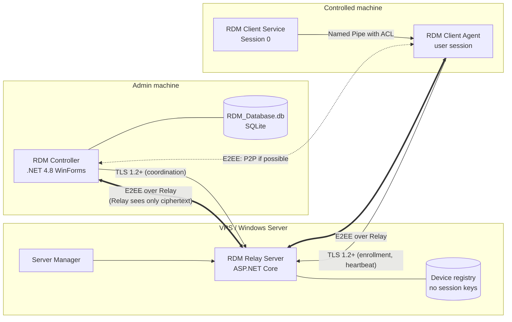
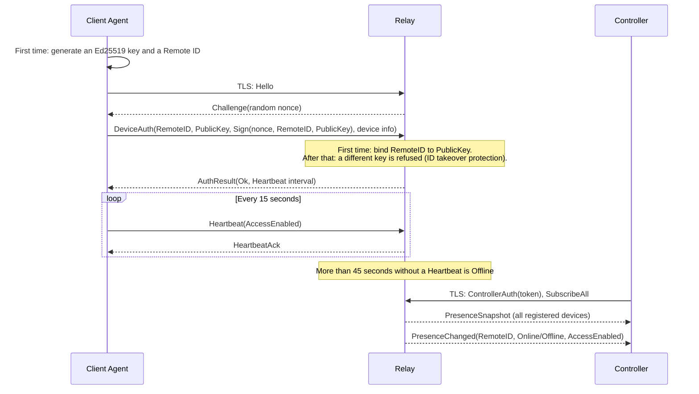
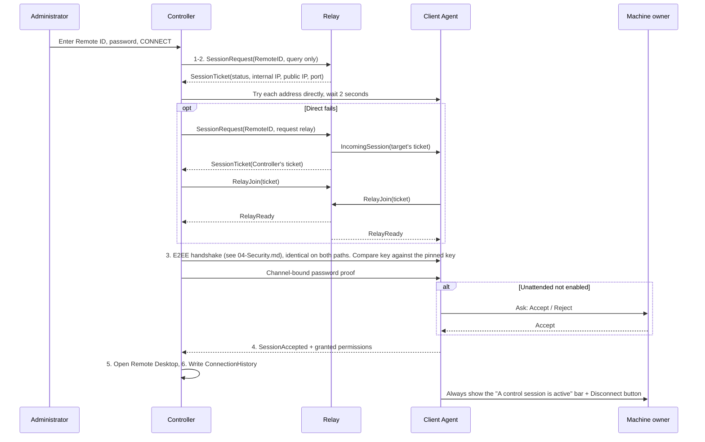
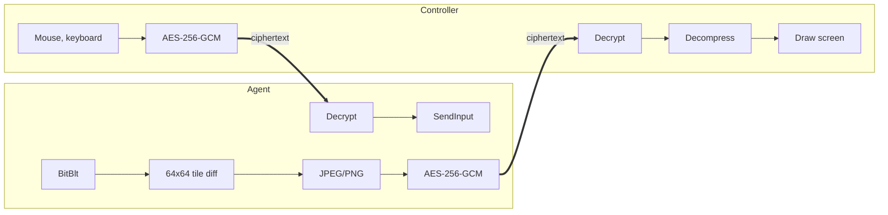
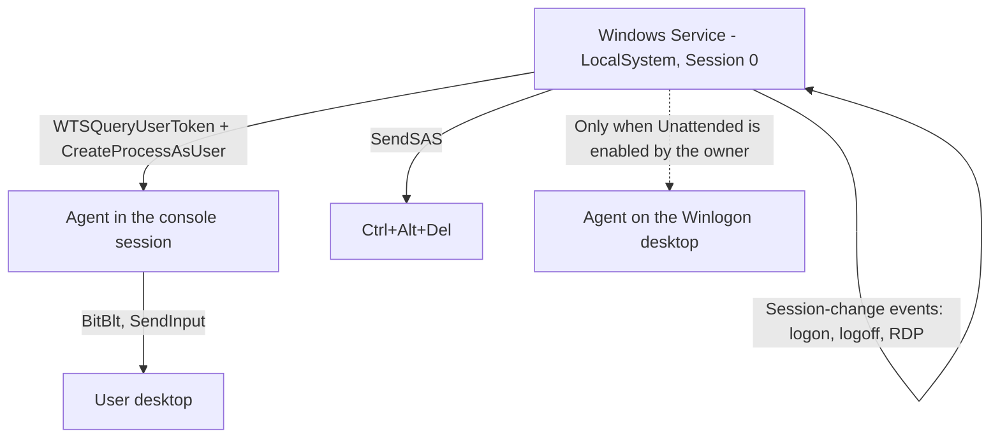

# 02 – Architecture and Data Flow (Steps 3–4)

## 0. Architecture change: a single TeamViewer-style program

By the project owner's decision, the Controller and Client are merged into **one program, `RDM.exe`**, replacing the two separate programs in Sections 3, 14 and 15 of the specification. The main window has two parts: "Allow control" and "Control another machine". A quick connection needs no RDM sign-in; the device-management part opens in its own window and requires sign-in.

The code still separates responsibilities: `RDM.Client` and `RDM.Controller` are libraries, `RDM.UI` holds shared interface pieces, and `RDM.App` is the runnable program. The sections below still say "Controller" and "Client" by the machine's **role** in a session.

Finding a machine on the LAN: `RDM.exe` answers UDP 7445 when the Remote ID matches. The returned address is only a hint; identity is verified by keys in the E2EE handshake.

## 1. Overview

## 2. Per-project responsibilities

| Project | Framework | Platform | Responsibility | Dependencies |
|---|---|---|---|---|
| RDM.Shared | netstandard2.0 | x86, x64 | Models, DTOs, Protocol, Security (crypto, KeyManager) | references no other project |
| RDM.Data | net48 | x86, x64 | SQLite, Repository, Migration, Backup, data business services | Shared |
| RDM.UI | net48 WinForms | x86, x64 | Theme, owner-drawn controls, icons | references no other project |
| RDM.Controller | net48 library | x86, x64 | Controller role: management UI, control session | Shared, Data, UI |
| RDM.Client | net48 library | x86, x64 | Controlled role: screen capture, input, Service | Shared, UI |
| RDM.App | net48 WinForms, `RDM.exe` | x86, x64 | Runnable program, main window | all of the above |
| RDM.Server | ASP.NET Core | x64 | Registry, authentication, coordination, relay | Shared |
| RDM.Tests | net48 xUnit | x86, x64 | Unit, Database, Security, Network Tests | Shared, Data, Controller |

Dependency rule: UI → Service → Repository → SQLite. Forms do not write SQL. Permissions are checked at the Service layer, not just by hiding a button on the UI.

**Framework choice for the Relay:** the spec allows ASP.NET Core. The proposal is **.NET 10 LTS**, because .NET 8 reaches end of support on 2026-11-10.

## 3. Enrollment and Online/Offline flow

**Changed from the original design:** devices authenticate by signing a nonce instead of using a DeviceToken. Reason: there is no token left to steal, the signature cannot be replayed, and the Relay only keeps the public key.

**Enrollment protection:** set `Relay:EnrollmentTokenSha256` so only devices with the code can enroll. Left empty, anyone who connects to the Relay can enroll a new Remote ID, so it should be set when the Relay is open to the Internet.

**Scope of one Relay:** one Relay serves one organization. A Controller with the token sees every device; there is no multi-tenant separation yet.

## 4. Connection flow (Quick Connect)

**Relay path design:**
- **Ticket:** 32 random bytes, one per side, single-use, expires after 30 seconds. The Relay issues two tickets as a pair, so sessions are never mismatched.
- **From RelayReady onward** the Relay only copies raw bytes between the two TLS connections; it does not parse the content.
- **Any machine can request a session,** no Controller token required: access is decided by the target machine via password or the owner's acceptance. The Controller token is only for viewing all device status.
- **A meaningful error does not trigger another path:** a wrong pinned key, wrong password, or owner rejection is the final answer. Only when the machine is unreachable, or the wrong machine is reached due to a duplicate internal IP across two networks, is the next path tried.
- **No TCP hole punching.** Beyond NAT it goes through the Relay, so Relay bandwidth is a real cost at deployment.

## 5. In-session data flow

The channels (Screen, Input, File, Chat, Control) are multiplexed over one stream, with a credit window so a large file does not starve input.

The framing loop is designed not to block the UI: capture and network run on separate Tasks with a `CancellationToken`, and the Controller keeps only the latest frame, dropping old frames when the network is slow.

## 6. Session 0 Isolation

The Service does not capture or control the desktop itself. The Client still works without the Service installed (instant-support mode), but then there is no Unattended, UAC cannot be passed, and there is no Ctrl+Alt+Del.

## 7. Deployment sequence

| Phase | Scope | Current status in |
|---|---|---|
| 1–2 | Foundation, UI, Database, storage security | `07-BaoCaoKiemThu.md` |
| 3 | Client, Remote ID, enrollment, Heartbeat, Online/Offline, access authorization, plus the Relay's Device Registry. The Windows Service moves to Phase 4 | `07-BaoCaoKiemThu.md` |
| 4 | Direct session, E2EE, Screen Capture, mouse, keyboard, Windows Service. **Real mouse, keyboard and Service not yet tested** | `07-BaoCaoKiemThu.md`, section 3b |
| 5 | Data Relay, Internet connection, concurrent sessions. **Loopback-tested only; no TCP hole punching** | `07-BaoCaoKiemThu.md`, section 3d |
| 6–7 | File Transfer, Chat, extensions, final packaging | Not started |
