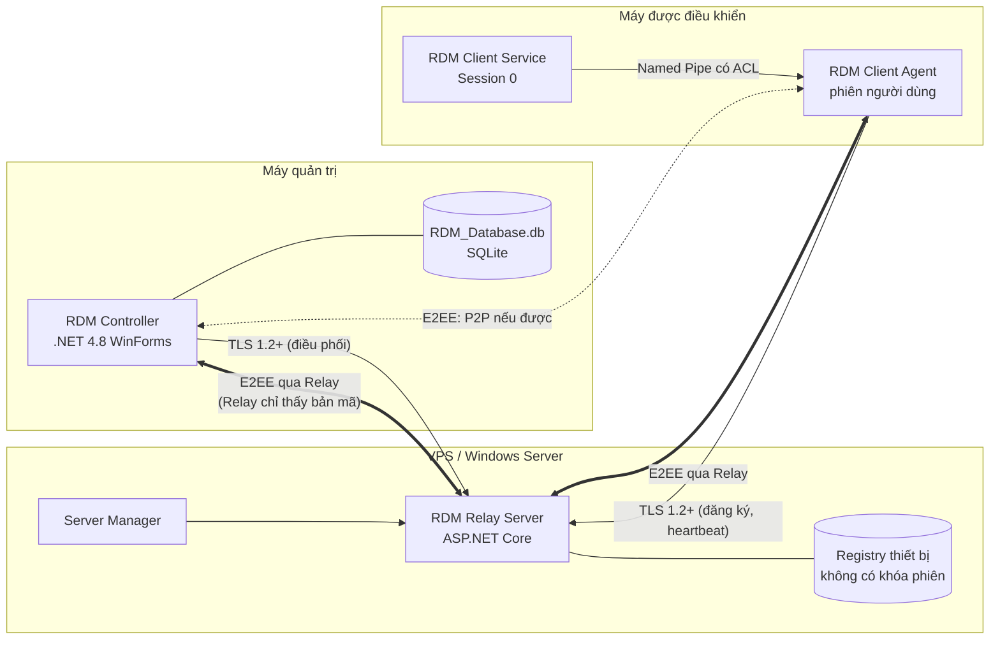
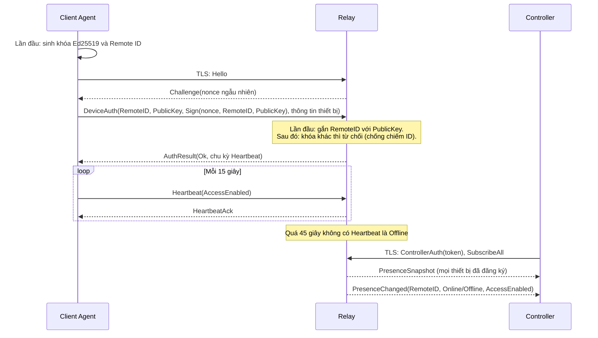
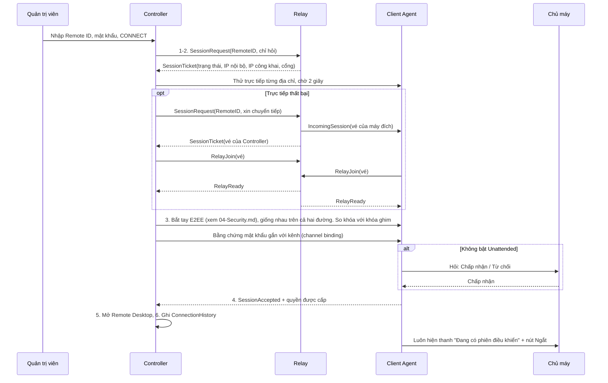
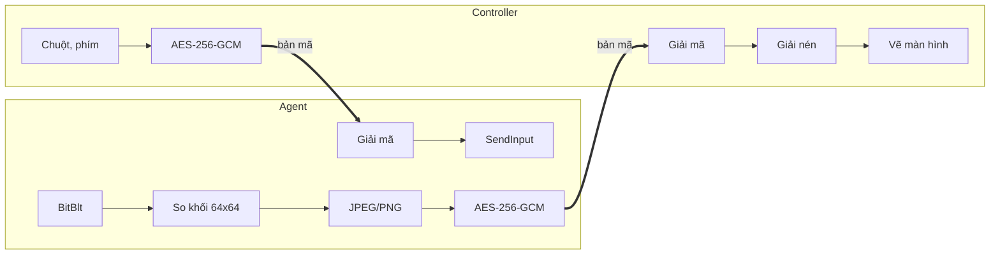
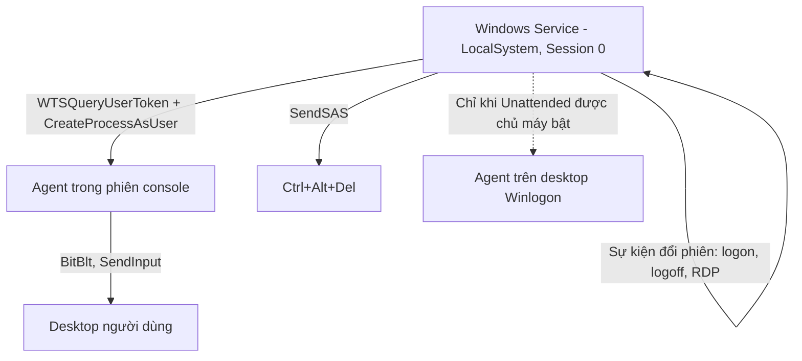

# 02 – Kiến trúc và luồng dữ liệu (Bước 3–4)

## 0. Thay đổi kiến trúc: một chương trình kiểu TeamViewer

Theo quyết định của chủ dự án, Controller và Client được gộp vào **một chương trình `RDM.exe`**, thay cho hai chương trình riêng ở Phần 3, 14, 15 của đặc tả. Cửa sổ chính có hai phần: "Cho phép điều khiển" và "Điều khiển máy khác". Kết nối nhanh không cần đăng nhập RDM; phần quản lý thiết bị mở trong cửa sổ riêng và phải đăng nhập.

Code vẫn tách trách nhiệm: `RDM.Client` và `RDM.Controller` là thư viện, `RDM.UI` chứa giao diện dùng chung, `RDM.App` là chương trình chạy. Các mục dưới đây vẫn gọi "Controller" và "Client" theo **vai trò** của máy trong một phiên.

Tìm máy trong LAN: `RDM.exe` trả lời UDP 7445 khi đúng Remote ID. Địa chỉ nhận được chỉ là gợi ý, danh tính được xác minh bằng khóa trong bắt tay E2EE.

## 1. Tổng thể

## 2. Trách nhiệm từng Project

| Project | Framework | Nền tảng | Trách nhiệm | Phụ thuộc |
|---|---|---|---|---|
| RDM.Shared | netstandard2.0 | x86, x64 | Model, DTO, Protocol, Security (crypto, KeyManager) | không tham chiếu Project khác |
| RDM.Data | net48 | x86, x64 | SQLite, Repository, Migration, Backup, dịch vụ nghiệp vụ dữ liệu | Shared |
| RDM.UI | net48 WinForms | x86, x64 | Theme, control tự vẽ, icon | không tham chiếu Project khác |
| RDM.Controller | net48 thư viện | x86, x64 | Vai trò điều khiển: phần quản lý, phiên điều khiển | Shared, Data, UI |
| RDM.Client | net48 thư viện | x86, x64 | Vai trò được điều khiển: chụp màn hình, input, Service | Shared, UI |
| RDM.App | net48 WinForms, `RDM.exe` | x86, x64 | Chương trình chạy, cửa sổ chính | tất cả ở trên |
| RDM.Server | ASP.NET Core | x64 | Registry, xác thực, điều phối, relay | Shared |
| RDM.Tests | net48 xUnit | x86, x64 | Unit, Database, Security, Network Tests | Shared, Data, Controller |

Quy tắc phụ thuộc: UI → Service → Repository → SQLite. Form không viết SQL. Quyền được kiểm tra ở tầng Service, không chỉ ẩn nút trên UI.

**Chọn framework cho Relay:** đặc tả cho phép ASP.NET Core. Đề xuất **.NET 10 LTS**, vì .NET 8 hết hỗ trợ vào 10/11/2026.

## 3. Luồng đăng ký và trạng thái Online/Offline

**Đã đổi so với thiết kế ban đầu:** thiết bị xác thực bằng chữ ký trên nonce thay vì DeviceToken. Lý do: không còn token nào để bị đánh cắp, chữ ký không phát lại được, và Relay chỉ giữ khóa công khai.

**Bảo vệ đăng ký:** đặt `Relay:EnrollmentTokenSha256` để chỉ thiết bị có mã mới đăng ký được. Để trống thì ai kết nối tới Relay cũng đăng ký được Remote ID mới, nên nên đặt khi Relay mở ra Internet.

**Phạm vi một Relay:** một Relay phục vụ một tổ chức. Controller có token thấy toàn bộ thiết bị; chưa có phân tách nhiều khách hàng.

## 4. Luồng kết nối (Quick Connect)

**Thiết kế đường chuyển tiếp:**
- **Vé:** 32 byte ngẫu nhiên, mỗi bên một vé, dùng một lần, hết hạn sau 30 giây. Relay phát hai vé theo cặp nên không ghép nhầm phiên.
- **Từ RelayReady trở đi** Relay chỉ chép byte thô giữa hai kết nối TLS, không phân tích nội dung.
- **Máy nào cũng xin được phiên,** không cần token Controller: quyền truy cập do máy đích quyết định bằng mật khẩu hoặc chủ máy chấp nhận. Token Controller chỉ dùng để xem toàn bộ trạng thái thiết bị.
- **Lỗi có ý nghĩa thì không thử đường khác:** sai khóa ghim, sai mật khẩu, chủ máy từ chối là câu trả lời cuối cùng. Chỉ khi không tới được, hoặc gặp nhầm máy do trùng IP nội bộ giữa hai mạng, mới thử đường tiếp theo.
- **Không có TCP hole punching.** Sau NAT là qua Relay, nên băng thông Relay là chi phí thật khi triển khai.

## 5. Luồng dữ liệu trong phiên

Các kênh (Screen, Input, File, Chat, Control) được ghép trên một luồng, có cửa sổ tín dụng để file lớn không làm nghẽn input.

Luồng đóng khung được thiết kế để không treo UI: capture và mạng chạy trên Task riêng có `CancellationToken`, Controller chỉ giữ frame mới nhất và bỏ frame cũ khi mạng chậm.

## 6. Session 0 Isolation

Service không tự chụp hay điều khiển desktop. Client vẫn dùng được khi không cài Service (chế độ hỗ trợ tức thời), nhưng khi đó không có Unattended, không qua được UAC và không có Ctrl+Alt+Del.

## 7. Trình tự triển khai

| Giai đoạn | Nội dung | Trạng thái hiện tại xem tại |
|---|---|---|
| 1–2 | Nền tảng, UI, Database, bảo mật lưu trữ | `07-BaoCaoKiemThu.md` |
| 3 | Client, Remote ID, đăng ký, Heartbeat, Online/Offline, xác thực truy cập, kèm Device Registry của Relay. Windows Service chuyển sang Giai đoạn 4 | `07-BaoCaoKiemThu.md` |
| 4 | Phiên trực tiếp, E2EE, Screen Capture, chuột, bàn phím, Windows Service. **Chuột, bàn phím thật và Service chưa được kiểm thử** | `07-BaoCaoKiemThu.md`, mục 3b |
| 5 | Relay dữ liệu, kết nối qua Internet, phiên đồng thời. **Chỉ kiểm thử trên loopback; chưa có TCP hole punching** | `07-BaoCaoKiemThu.md`, mục 3d |
| 6–7 | File Transfer, Chat, mở rộng, hoàn thiện đóng gói | Chưa bắt đầu |
