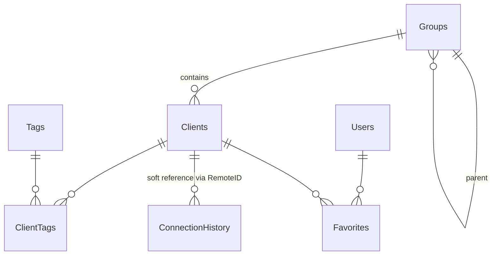

# 03 – SQLite Database Design (Step 5)

**File:** `RDM_Database.db`, in `%LOCALAPPDATA%
\RDM\` (user ACL). The folder can be changed with the `RDM_DATA_DIR` environment variable.

**Connection settings:** WAL, `foreign_keys=ON`, `busy_timeout=5000`. Each operation opens a short, pooled connection and never holds a transaction across a network or UI call, so the database is never locked for long.

## 1. Relationship diagram

## 2. Tables

Columns marked 🔒 are AES-256-GCM ciphertext.

| Table | Key columns | Notes |
|---|---|---|
| **Clients** | ID, DeviceID (unique), RemoteID (unique), DeviceName, Description, GroupID, EncryptedCredential 🔒, IPAddress, MacAddress, OperatingSystem, Architecture, LastOnline, CreatedDate, IsFavorite, IsEnabled | RemoteID is the business key |
| **Groups** | ID, Name (unique, case-insensitive), Description, ParentID, CreatedDate | Deleting a group returns its devices to "no group" |
| **ConnectionHistory** | ID, RemoteID, DeviceName, ControllerUser, StartTime, EndTime, Duration, ConnectionType, ConnectionStatus | Keeps DeviceName so history stays intact when a device is deleted |
| **Users** | ID, UsernameHash, EncryptedUsername 🔒, PasswordHash 🔒, EncryptedFullName 🔒, EncryptedEmail 🔒, Role, IsEnabled, FailedAttempts, LockedUntil, MustChangePassword, CreatedDate, LastLogin | `UsernameHash` is HMAC-SHA256 for lookup without revealing the name |
| **Settings** | Key, Value, IsEncrypted, UpdatedDate | Sensitive values use `IsEncrypted=1`, Value 🔒 |
| **Favorites** | UserID, ClientID, CreatedDate | Favorites per user |
| **AuditLogs** | ID, Timestamp, EventType, Severity, Username, RemoteID, DeviceName, Details, Success | Never contains secrets |
| **SecurityKeys** | ID, Purpose, Version, Status, WrappedKey, ProtectionScheme, CreatedDate, RotatedDate, RevokedDate, Fingerprint | `WrappedKey` is protected by DPAPI. `Fingerprint` is a shortened SHA-256 of the key |
| **Tags, ClientTags** | ID, Name / ClientID, TagID | Satisfies "Tagging" (Section 6) |
| **SchemaVersion** | Version, AppliedDate, Description | Migration history |

**On `Clients.IsFavorite` and the `Favorites` table:** the spec requires both. `Favorites` is the primary source (per user). `IsFavorite` is updated in the same transaction and means "at least one user marked it".

## 3. Indexes

`Clients(GroupID)`, `Clients(DeviceName)`, `Clients(LastOnline)`, `ConnectionHistory(StartTime)`, `ConnectionHistory(RemoteID)`, `AuditLogs(Timestamp)`, `AuditLogs(EventType)`, `SecurityKeys(Purpose, Status)`. RemoteID, DeviceID and UsernameHash have unique indexes.

## 4. Migration

- `PRAGMA user_version` together with the `SchemaVersion` table. Migrations are a versioned list, each step running in one transaction.
- A DB file with a version **newer** than the application: refuse to open, do not overwrite.
- Before raising the version of a DB that already has data: automatically back up to `RDM_Database.pre-v{N}.bak`.

## 5. Encryption: the decision

**Per-field encryption was chosen**, not full-file encryption.

| Option | .NET 4.8, x86/x64 | Problem |
|---|---|---|
| SEE | Yes | Paid license |
| SQLCipher via Microsoft.Data.Sqlite | Possible | Driver change, adds native, not verified on Windows 7 |
| **Per-field encryption** | **Yes** | Metadata (machine name, IP) is still readable if the file is stolen |

**Remaining risk, for the project owner to accept:** a thief of the DB file can see device names, IPs, Remote IDs, connection history, and usernames appearing in `AuditLogs` / `ConnectionHistory`, but cannot see passwords, credentials, tokens, full names, emails or keys. To hide metadata too, use BitLocker on the drive.

## 6. Backup/Restore

- Uses the SQLite Online Backup API, so it produces a consistent copy even while writing.
- The `.rdmbak` file = header + AES-256-GCM(DB + data key), the key derived from the **backup password** via PBKDF2. The DPAPI key does not work on another machine, so the data key is re-wrapped with the backup password.
- Restore: verify GCM (a wrong password or a tampered file is both refused) → check SQLite integrity → back up the current DB → replace → re-wrap the key with the new machine's DPAPI.
