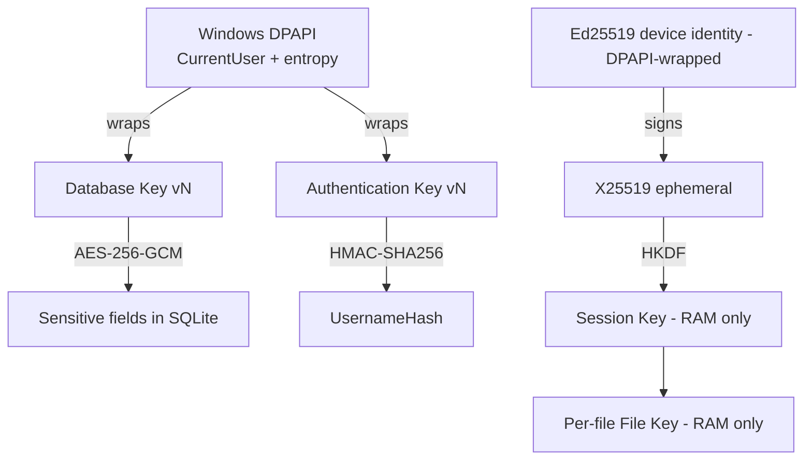
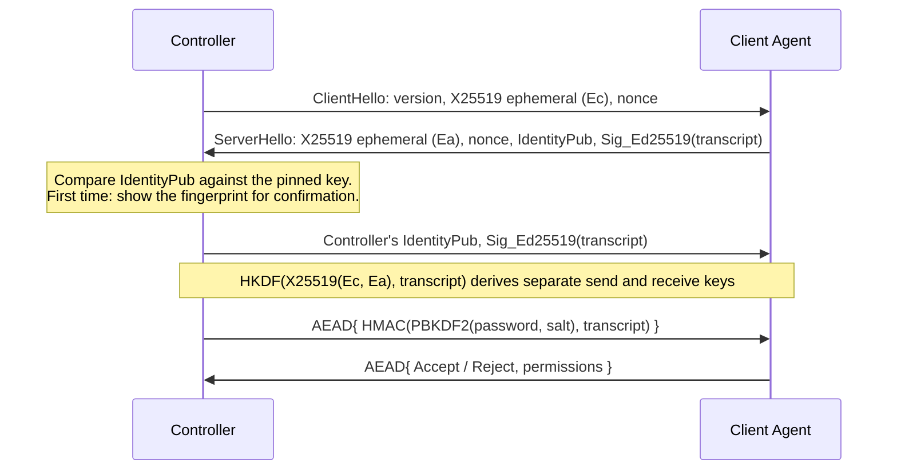

# 04 – Security Architecture, TLS and E2EE (Step 6)

## 1. Threat model

| Actor | Capability | Primary control |
|---|---|---|
| Eavesdropper / MITM on the network | Read, modify packets | TLS, E2EE |
| **Compromised Relay** | Read everything passing through, swap public keys | E2EE, end-to-end key pinning, Relay has no session keys |
| Thief of the `RDM_Database.db` file | Read offline | Field encryption, DPAPI-wrapped keys |
| Low-privilege Controller user | Perform over-privileged actions | RBAC at the Service layer, Audit |
| Password guesser | Try passwords | PBKDF2, account lockout, rate limiting |

**Not defended:** malware running with the privileges of the signed-in user can call DPAPI as that user. This is an inherent limitation of DPAPI.

## 2. Key hierarchy

Each purpose has its own key (`KeyPurpose`), every key is generated by a CSPRNG, and no key is in the source. `KeyManager` is the only gateway to the keys.

## 3. Storage encryption (coded, Phase 2)

| Component | Algorithm | Reason |
|---|---|---|
| Sensitive fields | AES-256-GCM, 96-bit random nonce, 128-bit tag | AEAD. BouncyCastle because .NET 4.8 has no `AesGcm` |
| AAD | `table|column|row key` | Blocks swapping ciphertext between rows (not just tampering) |
| Format | `v1 | keyVersion | nonce | ciphertext+tag` | Allows gradual key rotation |
| Passwords | PBKDF2-HMAC-SHA256, 600,000 iterations, 16-byte per-record salt | Per OWASP recommendation; can be raised and rehashed on sign-in |
| Comparison | Constant time | Anti timing attack |

**Key rotation:** create a new version → decrypt and re-encrypt everything in one transaction → mark the old version `Retired`. A mid-way failure rolls back.

**Key revocation:** move to `Revoked`. Every decrypt request with this key fails rather than silently returning data. Revocation does **not** disable old backup files, because a backup carries a copy of the key, protected by the backup password.

**Not yet available:** scheduled automatic key rotation; currently done manually in the Security Center.

## 4. Transport: TLS (coded for the channel to the Relay, Phase 3)

- TLS 1.2 minimum. TLS 1.3 is only added on Windows 11 / Server 2022 and later.
- Any `SslPolicyErrors` other than `None` is an error. There is **no** switch to ignore certificate errors in any build.
- The **pinned key** (SHA-256 of the public key) is the explicit trust anchor for a Relay using an internal certificate. The pinned key only replaces the CA chain: it must still be the right key, the right hostname, and not expired. Without pinning, a trusted CA and revocation checking are required.
- The Relay certificate is recommended to be ECDSA P-256 for Windows 7 compatibility. `RDM.Server --generate-cert` produces this type.
- If the minimum is not met: warn and **refuse the Internet connection**, do not downgrade.

## 5. E2EE (coded, Phase 4)

TLS only protects up to the Relay. Therefore all session data goes through the E2EE layer, even over P2P.

**Deviation from Section 8.1, for the project owner to confirm:** the P2P channel uses E2EE, without an additional TLS wrapper. A self-signed TLS with no root of trust adds nothing over the Ed25519 signature on the transcript plus key pinning.

**StrictPinning (on by default):** an unpinned key must be confirmed by re-entering the fingerprint read from the target machine. Disabled, it only takes a button press. Neither mode auto-trusts an unknown key.

| Requirement | Solution |
|---|---|
| Relay cannot swap keys | Ed25519 signature on the transcript; the identity key is **pinned** on the Controller |
| Forward secrecy | X25519 ephemeral, destroyed after the handshake |
| Non-repeating nonce | `direction (4 bytes) || counter (8 bytes)`; a separate key per direction |
| Anti-replay | The counter must strictly increase; a wrong packet is dropped and the session closed |
| Session rekey | HKDF ratchet after every 1 GiB or 60 minutes |
| Emergency switch | Owner disconnect: tells the Controller not to auto-reconnect, and blocks new connections for 60 seconds, even Unattended |
| Password never crosses the Relay | Only an HMAC proof bound to the transcript is sent, inside AEAD. The Relay sees nothing to crack offline |

**Remaining risk on the very first connection:** if the user accepts a forged fingerprint, a malicious Relay could capture the password proof and crack it offline. Mitigated by showing the fingerprint clearly, allowing pre-registration of the key on the LAN, and the `StrictPinning` policy that refuses unpinned keys. When a pinned key changes, the connection is **blocked** with a red warning, not just a Yes/No prompt.

## 5b. Relay forwarding (coded, Phase 5)

The Relay is treated as untrusted for session content. The E2EE protocol is unchanged over the Relay, so a malicious Relay can do the following, and only the following:

| A malicious Relay can | Cannot |
|---|---|
| Know who connects to whom, when, and how much traffic | Read the screen, keystrokes, passwords, usernames |
| Block or cut a session | Modify or inject data without being detected |
| Intrude on the **first connection** if the user skips fingerprint comparison | Impersonate a machine whose key is pinned |

**New attack surface:** every registered device can request a session with any Remote ID.
- The reply code reveals whether a Remote ID exists and is Online. A limit of 30 requests per minute slows enumeration but does not stop it: many devices can still probe faster. A Remote ID is not a secret.
- **Harassing the owner:** the permission dialog is still bounded by the 10-second timeout, like a direct connection.
- **Using the Relay as a free tunnel:** two registered devices could use the Relay to transfer arbitrary data. **Therefore an enrollment code must be set when the Relay is open to the Internet.**

A ticket is not bound to the holder's TLS: anyone who obtains a ticket within 30 seconds can take the slot on the forwarding path, but still cannot pass the E2EE handshake, so it only causes a connection error. Tickets only travel inside TLS and are not logged.

## 6. Session

Each Session has a random 128-bit ID, its own key, a lifetime, and two-sided authentication. On disconnect: wipe keys from memory (`Array.Clear`, within the limits of managed memory), revoke the token, close the socket; the old ID is refused.

**Limitation:** .NET's GC may have copied the key array before it was wiped, so this is "best-effort wiping" as the spec says, not an absolute guarantee.

## 7. Controller user authentication

- No default account or password. The first run requires creating an Administrator.
- 5 wrong attempts: 15-minute lockout. Audited. The error message does not reveal whether an account exists.
- A non-existent account still runs PBKDF2 so it cannot be inferred from response time.
- Roles: **Administrator**, **Operator**, **Viewer**.

## 8. Audit Log

`AuditLogger` only takes structured fields and filters `Details` by sensitive keywords (`password`, `token`, `key`, ...), so an accidental pass-through is not written out.

## 9. Test plan (Section 8.9)

| Test | Phase | How |
|---|---|---|
| SQL Injection | 2 | Malicious payloads into Search, Name |
| Database Theft | 2 | Read the raw DB file, verify no secrets |
| Key Rotation | 2 | Rotate the key, read back, try the revoked key |
| Backup/Restore Security | 2 | Wrong password, flip one byte, no plaintext secrets |
| Brute Force | 2 (local), 5 (Relay) | Lock after N failures |
| Unauthorized Access | 2, 5 | Call the Service with a low role |
| File Tampering (ciphertext) | 2 | Flip bits, swap ciphertext between rows |
| MITM, Certificate Validation | 4 | Self-signed certificate, wrong hostname, expired |
| Replay, Session Hijacking, Token Theft | 4–5 | Replay packets, old token |
| Path Traversal, File Tampering | 6 | `..\`, UNC, `:ADS` stream |
