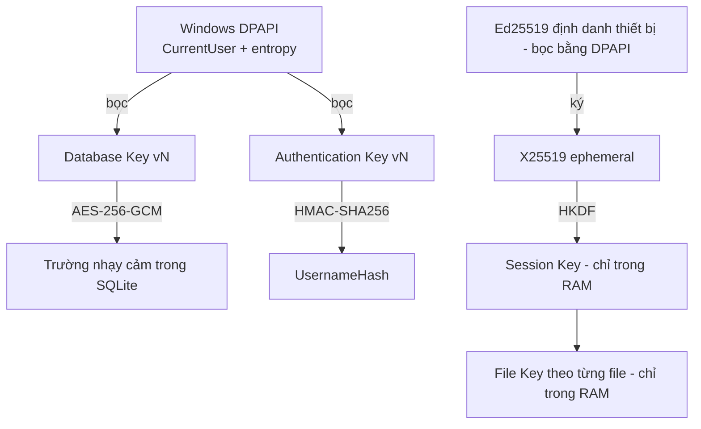
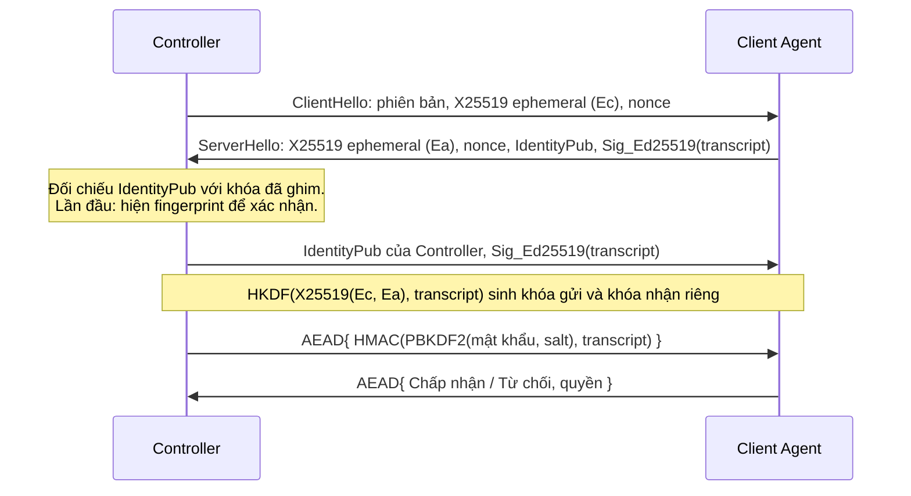

# 04 – Security Architecture, TLS và E2EE (Bước 6)

## 1. Mô hình đe dọa

| Tác nhân | Khả năng | Kiểm soát chính |
|---|---|---|
| Kẻ nghe lén / MITM trên mạng | Đọc, sửa gói tin | TLS, E2EE |
| **Relay bị chiếm quyền** | Đọc mọi thứ đi qua, tráo khóa công khai | E2EE, ghim khóa đầu cuối, Relay không có khóa phiên |
| Kẻ trộm file `RDM_Database.db` | Đọc offline | Mã hóa trường, khóa bọc DPAPI |
| Người dùng Controller quyền thấp | Thực hiện thao tác vượt quyền | RBAC ở tầng Service, Audit |
| Người dò mật khẩu | Thử mật khẩu | PBKDF2, khóa tài khoản, Rate Limiting |

**Không chống được:** malware có quyền của chính user đang đăng nhập có thể gọi DPAPI như user đó. Đây là giới hạn cố hữu của DPAPI.

## 2. Phân cấp khóa

Mỗi mục đích một khóa riêng (`KeyPurpose`), khóa nào cũng sinh bằng CSPRNG, không có khóa nào nằm trong source. `KeyManager` là cửa duy nhất tiếp cận khóa.

## 3. Mã hóa lưu trữ (đã lập trình, Giai đoạn 2)

| Thành phần | Thuật toán | Lý do |
|---|---|---|
| Trường nhạy cảm | AES-256-GCM, nonce ngẫu nhiên 96 bit, tag 128 bit | AEAD. BouncyCastle vì .NET 4.8 không có `AesGcm` |
| AAD | `bảng|cột|khóa dòng` | Chặn việc tráo bản mã giữa các dòng (không chỉ chặn sửa) |
| Định dạng | `v1 | keyVersion | nonce | ciphertext+tag` | Cho phép xoay khóa dần |
| Mật khẩu | PBKDF2-HMAC-SHA256, 600.000 vòng, salt 16 byte riêng | Theo khuyến nghị OWASP; có thể tăng và tự băm lại khi đăng nhập |
| So sánh | Thời gian không đổi | Chống timing attack |

**Xoay khóa:** tạo phiên bản mới → giải mã và mã hóa lại toàn bộ trong một transaction → đánh dấu bản cũ `Retired`. Thất bại giữa chừng thì rollback.

**Thu hồi khóa:** chuyển `Revoked`. Mọi yêu cầu giải mã bằng khóa này đều thất bại, chứ không âm thầm trả về dữ liệu. Thu hồi **không** vô hiệu hóa được file backup cũ, vì backup mang theo bản sao khóa, được bảo vệ bằng mật khẩu backup.

**Chưa có:** xoay khóa tự động theo lịch; hiện chỉ làm thủ công trong Security Center.

## 4. Truyền tải: TLS (đã lập trình cho kênh tới Relay, Giai đoạn 3)

- Tối thiểu TLS 1.2. Chỉ thêm TLS 1.3 trên Windows 11 / Server 2022 trở lên.
- Mọi `SslPolicyErrors` khác `None` đều là lỗi. **Không có** công tắc bỏ qua lỗi chứng thư ở bất kỳ bản build nào.
- **Khóa ghim** (SHA-256 của khóa công khai) là neo tin cậy tường minh cho Relay dùng chứng thư nội bộ. Khóa ghim chỉ thay thế chuỗi CA: vẫn phải đúng khóa, đúng hostname, còn hạn. Không ghim thì bắt buộc CA tin cậy và kiểm tra thu hồi.
- Chứng thư Relay khuyến nghị ECDSA P-256 để tương thích Windows 7. `RDM.Server --generate-cert` sinh loại này.
- Không đạt tối thiểu: cảnh báo và **từ chối kết nối Internet**, không hạ cấp.

## 5. E2EE (đã lập trình, Giai đoạn 4)

TLS chỉ bảo vệ tới Relay. Vì vậy mọi dữ liệu phiên đều đi qua lớp E2EE, kể cả khi dùng P2P.

**Lệch so với Phần 8.1, cần chủ dự án xác nhận:** kênh P2P dùng E2EE, không bọc thêm TLS. TLS tự ký không có gốc tin cậy nên không thêm bảo đảm nào so với chữ ký Ed25519 trên transcript và khóa ghim.

**StrictPinning (mặc định bật):** khóa chưa ghim phải được xác nhận bằng cách nhập lại fingerprint đọc từ máy đích. Tắt đi thì chỉ cần bấm nút. Hai chế độ đều không tự tin cậy khóa lạ.

| Yêu cầu | Giải pháp |
|---|---|
| Relay không tráo được khóa | Chữ ký Ed25519 trên transcript; khóa định danh được **ghim** trên Controller |
| Forward secrecy | X25519 ephemeral, hủy sau bắt tay |
| Nonce không lặp | `hướng (4 byte) || bộ đếm (8 byte)`; mỗi hướng một khóa |
| Chống Replay | Bộ đếm phải tăng nghiêm ngặt, gói sai bị loại và phiên bị đóng |
| Đổi khóa phiên | Ratchet HKDF sau mỗi 1 GiB hoặc 60 phút |
| Công tắc khẩn cấp | Chủ máy ngắt: báo Controller không tự kết nối lại, và chặn kết nối mới 60 giây, kể cả Unattended |
| Mật khẩu không qua Relay | Chỉ gửi bằng chứng HMAC gắn với transcript, bên trong AEAD. Relay không thấy gì để dò offline |

**Rủi ro còn lại ở lần kết nối đầu tiên:** nếu người dùng bấm chấp nhận fingerprint giả, một Relay độc hại có thể nhận được bằng chứng mật khẩu và dò offline. Giảm thiểu bằng cách hiện fingerprint rõ ràng, cho phép đăng ký trước khóa trên LAN, và có chính sách `StrictPinning` để từ chối khóa chưa ghim. Khi khóa đã ghim thay đổi, kết nối bị **chặn** với cảnh báo đỏ, không chỉ hỏi Yes/No.

## 5b. Chuyển tiếp qua Relay (đã lập trình, Giai đoạn 5)

Relay được coi là không đáng tin đối với nội dung phiên. Giao thức E2EE không đổi khi đi qua Relay, nên Relay độc hại làm được những việc sau, và chỉ những việc sau:

| Relay độc hại có thể | Không thể |
|---|---|
| Biết ai kết nối tới ai, lúc nào, lưu lượng bao nhiêu | Đọc màn hình, chữ gõ, mật khẩu, tên người dùng |
| Chặn hoặc cắt phiên | Sửa hay chèn dữ liệu mà không bị phát hiện |
| Chen vào **lần kết nối đầu** nếu người dùng bỏ qua đối chiếu fingerprint | Giả mạo máy đã ghim khóa |

**Bề mặt tấn công mới:** mọi thiết bị đã đăng ký đều xin được phiên tới mọi Remote ID.
- Mã trả lời cho biết Remote ID có tồn tại và có Online không. Giới hạn 30 yêu cầu mỗi phút làm chậm việc dò, nhưng không ngăn hẳn: nhiều thiết bị vẫn dò được nhanh hơn. Remote ID không phải bí mật.
- **Quấy rầy chủ máy:** hộp thoại xin phép vẫn bị giới hạn bởi thời gian chờ 10 giây như kết nối trực tiếp.
- **Dùng Relay như đường hầm miễn phí:** hai thiết bị đều đã đăng ký có thể dùng Relay để truyền dữ liệu bất kỳ. **Vì vậy phải đặt mã đăng ký khi Relay mở ra Internet.**

Vé không gắn với TLS của người giữ vé: ai lấy được vé trong 30 giây có thể chiếm chỗ trên đường chuyển tiếp, nhưng vẫn không qua được bắt tay E2EE, nên chỉ gây lỗi kết nối. Vé chỉ đi trong TLS và không được ghi log.

## 6. Session

Mỗi Session có ID 128 bit ngẫu nhiên, khóa riêng, thời hạn, xác thực hai đầu. Khi ngắt: xóa khóa khỏi bộ nhớ (`Array.Clear`, trong giới hạn của bộ nhớ managed), thu hồi token, đóng socket; ID cũ bị từ chối.

**Giới hạn:** GC của .NET có thể đã sao chép mảng khóa trước khi bị xóa, nên đây là "hủy khi có thể" như đặc tả, không phải đảm bảo tuyệt đối.

## 7. Xác thực người dùng Controller

- Không có tài khoản hay mật khẩu mặc định. Lần chạy đầu bắt buộc tạo Administrator.
- Sai 5 lần: khóa 15 phút. Ghi Audit. Thông báo lỗi không tiết lộ tài khoản có tồn tại hay không.
- Tài khoản không tồn tại vẫn chạy PBKDF2 để không lộ qua thời gian phản hồi.
- Vai trò: **Administrator**, **Operator**, **Viewer**.

## 8. Audit Log

`AuditLogger` chỉ nhận các trường có cấu trúc và lọc `Details` theo từ khóa nhạy cảm (`password`, `token`, `key`, ...), để lỡ tay truyền vào cũng không bị ghi ra.

## 9. Kế hoạch kiểm thử (Phần 8.9)

| Kiểm thử | Giai đoạn | Cách kiểm |
|---|---|---|
| SQL Injection | 2 | Payload độc hại vào Search, Name |
| Database Theft | 2 | Đọc file DB thô, xác minh không có secret |
| Key Rotation | 2 | Xoay khóa, đọc lại, thử khóa thu hồi |
| Backup/Restore Security | 2 | Sai mật khẩu, sửa 1 byte, secret không có dạng rõ |
| Brute Force | 2 (local), 5 (Relay) | Khóa sau N lần sai |
| Unauthorized Access | 2, 5 | Gọi Service với vai trò thấp |
| File Tampering (bản mã) | 2 | Lật bit, tráo bản mã giữa các dòng |
| MITM, Certificate Validation | 4 | Chứng thư tự ký, sai hostname, hết hạn |
| Replay, Session Hijacking, Token Theft | 4–5 | Phát lại gói, token cũ |
| Path Traversal, File Tampering | 6 | `..\`, UNC, stream `:ADS` |
